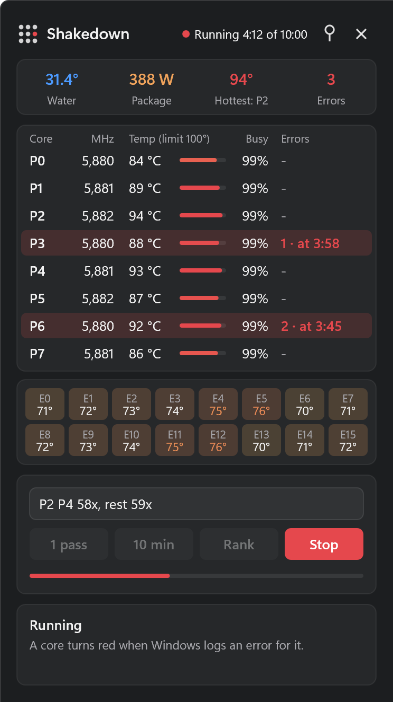
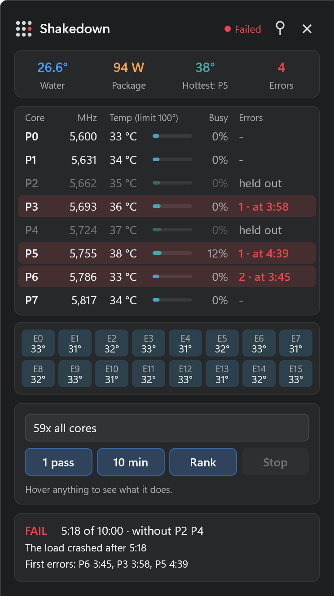

# Shakedown

Runs a real all-core load on your PC and tells you which CPU cores failed, when, and how hot they were.

For overclockers who want to know which cores hold a setting and which do not, without guessing from a crash.

<p>


</p>

## What it does

- Starts a load you choose (Cinebench by default) and watches it.
- Reads the Windows hardware error log while it runs and matches every error to a core.
- Logs each core's real clock, temperature and whether it throttled.
- Closes the load by itself when it crashes, so no error dialog waits for a click.
- Ends with a verdict: pass or fail, why, and a line per core.
- Keeps every run in a ledger, so you can see which setting bought what.

It does not start with Windows. You start it when you are tuning, it sits in the tray for that session, and it is gone when you exit it. While its panel is closed and no run is going it does nothing at all. It changes no setting on your PC.

## Finding the weak cores

**Rank** (`shakedown-cli rank`) runs the load, takes the cores the error log named, and runs it again with those cores held out. It repeats until the load passes. The order in which cores drop out is the ranking, weakest first, and you have it before you change anything in the BIOS.

A held-out core is kept idle with a job affinity limit, which the load cannot undo.

## Use

1. Put `shakedown.exe` and `shakedown-cli.exe` in a folder. Copy `shakedown.example.ini` there as `shakedown.ini` and set the path to your load.
2. Optional, for temperatures and throttling: install [PawnIO](https://pawnio.eu) and put `IntelMSR.bin` (from [PawnIO.Modules](https://github.com/namazso/PawnIO.Modules/releases)) beside the programs. The panel then offers **Install the helper**, which asks for admin rights one time.
3. Start `shakedown.exe`. Its panel opens above the tray, and its icon stays in the tray until you exit.

In the panel:

- **1 pass**, **10 min** and **Rank** start a run. **Stop** ends it.
- Hover anything and the line under the buttons says what it does.
- Every core has a line (or a cell, for efficiency cores) with its clock, temperature and load. A core turns red the moment Windows logs an error for it.
- Click a core to hold it out of the next run.
- Type what you are testing (for example `P0 P1 59x, rest 58x`) and it is kept with the result.
- The panel closes when you click elsewhere, like the system tray menus. The **pin** keeps it open. Click the tray icon to bring it back.
- A run keeps going with the panel closed. The tray icon shows progress on hover and tells you when the run ends.
- The **x** exits Shakedown.

The same from a terminal, for scripts:

```
shakedown-cli run                      one pass of the load
shakedown-cli run --minutes 10         a 10 minute run
shakedown-cli run --exclude 2,4        the same with P-cores 2 and 4 held out
shakedown-cli run --soak 40            wait until the water is 40 C, then start
shakedown-cli rank --minutes 10        find the failing cores, weakest first
shakedown-cli sensors                  cores, clocks and temperatures right now
shakedown-cli whea --minutes 120       hardware errors Windows logged, by core
shakedown-cli watch                    log sensors and errors with no load
shakedown-cli install                  the helper, without the window
```

`--note "P0 P1 59x, rest 58x"` writes what you are testing into the ledger.

Each run writes `runs\<time>-<label>.csv` (a line every 2 seconds), `.txt` (the verdict) and one line in `ledger.csv`.

## What counts as a pass

All of these:

- the load finished, for the whole time asked;
- Windows logged no hardware error during it;
- no core throttled (thermal, PROCHOT, power or current limit);
- the load really kept the cores busy.

## Sensors

| | Without the helper | With the helper |
|---|---|---|
| Errors by core | Yes | Yes |
| Core clock | From Windows counters | From the CPU (APERF/MPERF) |
| Core and package temperature | No | Yes |
| Throttling, package power | No | Yes |

The helper is an on-demand task that runs Shakedown with admin rights while the panel is open or a run is going. It only reads sensors and writes them to a file. It takes no commands and starts nothing, and the load itself always runs with normal rights. `shakedown-cli uninstall` removes it.

Intel CPUs only for temperatures. Error matching works on any CPU that reports an APIC ID in its error records.

## Limits

- It cannot change clocks or voltages. You change those in the BIOS and run it again.
- A core that is held out makes no heat, so the other cores run a little cooler than in a full run. Confirm a ranking with a full run.
- If the PC freezes, the run ends with it. The log on disk is complete up to the last 2 seconds; pipe the output to another machine if you want it to survive.
- An error with no core named (or a crash with nothing logged) stops a ranking, because there is nothing to hold out.

## Build

Needs [zig](https://ziglang.org) and Python 3 with Pillow (for the icon).

```sh
./build.sh            # build/shakedown.exe and build/shakedown-cli.exe
```

## License

[PolyForm Noncommercial 1.0.0](LICENSE.md). Free to use, change and share. Not for sale.

## Credits

Sensor access through [PawnIO](https://pawnio.eu). The per-core idea follows [CoreCycler](https://github.com/sp00n/corecycler), which tests one core at a time; Shakedown tests them together and removes the ones that fail.
